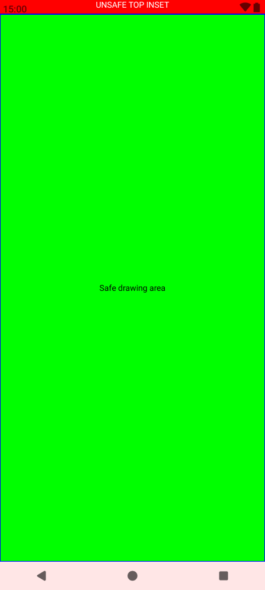
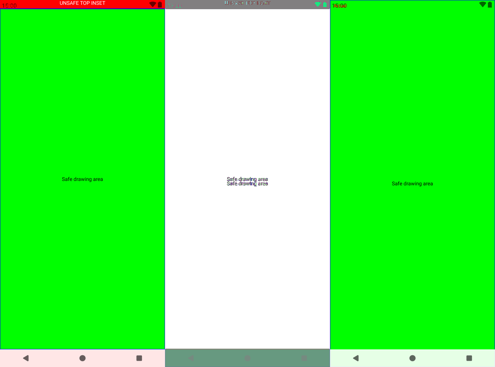
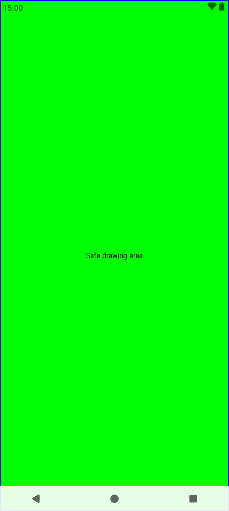

# Paparazzi `2.0.0-alpha05` vs `2.0.0-alpha05.1`

`./gradlew :app:verifyPaparazzi`

| `2.0.0-alpha05`        | Δ diff         | `2.0.0-alpha05.1`        |
|------------------------|----------------|--------------------------|
|  |  |  |

And this is how it looks in Android Studio Rabbit 1 | 2026.2.1

